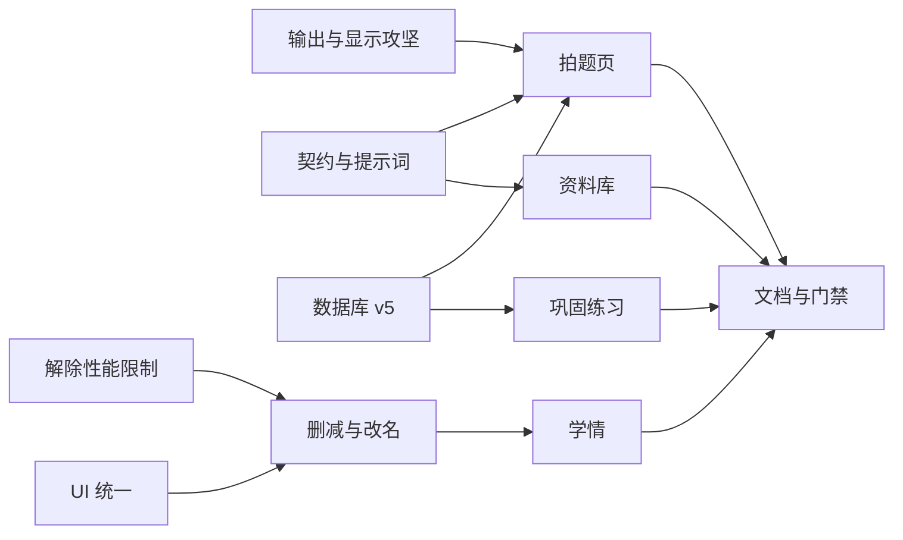

# 0.9.0 改造指南

制定日期：2026-11-21
依据：项目负责人 2026-11-21 给出的 0.9 需求口径（含随后的九条裁决）
起点：0.8.0（Kotlin 原生，单 Activity + Compose，Room 为本地唯一数据源）

本文只回答四件事：改什么、按什么顺序改、怎么算改完、各要多久。不写代码。

## 一、适用范围

- 本版是单端 Android 的原生改造，不涉及跨端、不涉及后端、不涉及云同步。
- 完成后版本号为 0.9.0；`CHANGELOG.md` 在开发期先记入 `[Unreleased]`，发版时再落版本号。
- 1.0 的 UniApp 改造已于 2026-11-21 整批回退（见 `CHANGELOG.md` `[Unreleased]`），本版与跨端无关，
  不要按跨端思路理解「移除性能限制」。

## 二、三条总则

### 2.1 解除旧的安卓性能限制

0.8.0 的约束原本是为「中低端老机 + 全量功能」定的，散落在 `AGENTS.md` 5.6、`docs/架构.md` 第十章、
`AGENTS.md` 7.1/7.3 的体积门禁三处。0.9 的做法是**直接解除，不引入设备档位判定**。

| 原约束 | 0.9 做法 | 落点 |
| --- | --- | --- |
| 只做位移 + 淡入 + 极轻缩放，禁毛玻璃、共享元素、循环动画 | 解除。按页面的表达需要自由使用，仅保留「按系统动画时长缩放反向补偿，下限 0.8」这一条无障碍要求 | `AGENTS.md` 5.6 整段重写 |
| 图表强制关动画、降采样至 60 点 | 默认 300ms 入场动画，降采样上限放到 120 点 | `docs/架构.md` 第十章 |
| 包体 arm64-only + 30MB 门禁 | 门禁放宽到 100MB；仍 arm64-only、仍保留 R8 与资源压缩 | `AGENTS.md` 7.1 / 7.3 |
| 公式渲染 WebView 实例复用，禁 MathJax | 保留（这是稳定性与内存问题，不是性能档位问题）；复用上限放宽到 2 个实例 | `docs/架构.md` 第十章 |

明确不做的事：

- **不做** `DeviceTier` 之类的运行时档位判定。默认按高性能渲染；真机出现掉帧时，按具体页面局部降级，
  不引入全局开关，避免同一份界面在不同机器上出现两套观感。
- **不放开**的三条底线：数据不出设备、不新增统计/广告/埋点/崩溃上报 SDK、日志与导出文件不含题干与作答。
  这三条属于合规承诺，不属于性能取舍。

### 2.2 UI 一致性

见第四章。四条门禁在 `AGENTS.md` 新增的「UI 一致性」一节中落地。

### 2.3 AI 输出质量

这一节是本版优先级最高的交付物，因为它决定学生看到的每一个字。

- **禁语气词**：不得出现「我们来看」「首先呢」「需要注意的是」「其实」「总的来说」「接下来我们」
  「综上所述」这类过渡语。答案直接给结论与步骤。
- **公式必须可渲染**：分式、根式、上下标、化学方程式（KaTeX 挂 mhchem 扩展）、方程组。
  任何一处退化成纯文本（例如露出 `\frac{1}{2}` 原文）都算缺陷。
- **步骤逐行**：一步一行，不把三个变形塞进一段。
- **选项逐行**：单选多选每项单独成行，标出选项字母，不横向挤在一起。
- **思路小字变色**：解释「为什么这样想」的内容用 `Tokens.Reasoning`，具体计算用 `Tokens.Calculation`，
  两者不得混用在同一段落里。
- **末尾列知识点**：每次完整解答的最后一段给本次涉及的知识点，用受控 ID 对应的名称，不自造名词。
- **「看标准解答」给完整答案**：题目、答案、完整过程齐全，不复述用户输入，不解释方法论。

这六条同时是提示词约束与界面验收项，缺一项即视为未完成。

## 三、页面改动清单

优先级：P0 阻断后续工作，P1 主流程，P2 打磨。工期单位：人日。

| 页面 / 模块 | 改动点 | 优先级 | 依赖 | 验收标准 | 工期 |
| --- | --- | --- | --- | --- | --- |
| 输出与显示攻坚 | 公式渲染补齐分式/根式/上下标/化学方程式（mhchem）；步骤与选项逐行；思路小字变色；末尾列知识点；全链路去语气词 | P0 | 无 | 数学分式与根式、化学方程式各 10 例零错位零丢符号；语气词命中 0 | 6 |
| 契约与提示词 | 阶段 A 增 `title`（题目概括，不超过 20 字）、`questionType`、`ambiguity`；按「学科 × 题型大类」建 10 至 12 套模板；每科一套考场思维闪记口径；去语气词硬约束；提示词版本升版 | P0 | 无 | 旧会话缺字段按 null 回退；版本升后缓存全失效；模板数与题型矩阵对得上 | 10 |
| 数据库 v5 | `mistake_record` 增 `standardSolution`、`solutionSource`、`solutionUpdatedAt`；`review_log` 增来源 | P0 | 无 | 有 schema 快照与 `MigrationTest`；旧库升级后读写正常 | 3 |
| 解除性能限制 | 删动效禁令与档位相关表述；图表与模糊按需启用；门禁改 100MB | P0 | 无 | 全仓无档位判断残留；规范与实现一致 | 2 |
| UI 统一 | 见第四章 | P0 | 无 | 见第四章验收 | 7 |
| 首页 | 删顶部标语与「拍一道不会题」入口；只留最近不熟知识点、近期学情、常用功能三块 | P1 | 学情统计口径 | 三块齐全且各有空态文案；无残留入口与死代码 | 1.5 |
| 拍题页 | 标题用 AI 题目概括；放大「直接讲解 / 提示引导」二选一；记住上次输入方式；精简提示文案并对齐发送按钮；三点菜单改底部抽屉，含拍照、相册选、导入其他、导入标准答案、考场思维闪记；「看标准解答」输出完整答案且无语气词；先识别学科与题型再按模板适配；不确定时按最可能项继续并打标；任一途径拿到正确答案都复写错题本完整过程，覆盖前弹窗确认 | P1 | 契约、v5、输出攻坚 | 十科闪记入口齐全且口径不串；打标必现；确认后错题详情即时刷新，取消后库无变化 | 13 |
| 陪伴页 | 公式展示优化；删计时、拍照、输入框示例提示；记住输入方式（与拍题页共用一项设置） | P2 | 契约 | 上下标与分式无溢出；计时移除后布局无空洞 | 3 |
| 功能中心 | 「多练知识点」改名「知识点」；「复习打卡」换成「巩固练习」；删卡点笔记入口 | P1 | 知识点页、巩固练习 | 宫格项与顺序正确，失效路由摘净 | 2 |
| 错题本 | 改名回「错题本」；状态徽标整体移除（列表、详情、筛选全部不再出现状态）；删右上角「去复习」；保留科目、知识点、错因、时间四类筛选 | P1 | v5 | 全页无徽标无状态筛选；右上角无按钮；历史数据不丢 | 2.5 |
| 知识点 | 删掌握度雷达、趋势、错因分布、重复筛选 | P2 | 无 | 只剩排行与入口，无空图表占位 | 3 |
| 巩固练习 | 取代复习打卡：选科目，再选大颗粒知识点与题型；按历史题或知识点生成题；不输入答案；展示答案与完整规范解析；用「做对了 / 仍不懂」更新掌握度并写 `review_log` | P1 | 知识点页、v5 | 两步选择可回退；两种出题来源各 3 题；两条自评路径都落日志 | 8.5 |
| 卡点笔记 | 整体删除（页面、路由、入口、备份字段） | P1 | 无 | 全仓无引用；旧备份恢复不崩 | 1 |
| 资料库 | 只展示导入的标准答案，改卡片式；供 AI 解析；旧解析保留不展示 | P1 | 导入落库结构 | 列表只查导入来源；分页正常；AI 解析可取消且写留痕 | 4 |
| 复习资料 | 历史入口收到右上角按钮；科目只显示设置中勾选的项 | P2 | 设置 | 右上角可进历史；科目行数等于勾选数 | 2 |
| 学情 | 左上角先选科目；下方只显示包含该科目的最近一场考试；无匹配给空态 | P2 | 统计口径 | 切科目后场次集合随之变化；空态文案指向该科尚无记录 | 3.5 |
| 设置 | 基本保持，仅加输入方式记忆项并回归 | P2 | 无 | 原有项全部可用，新增项落在同一分组 | 0.5 |
| 文档与门禁 | `AGENTS.md`、`CONTRIBUTING.md`、`docs/架构.md`、`docs/学情与成绩趋势.md`、`docs/偏离记录.md`、`CHANGELOG.md` | P1 | 全部功能稳定 | 无 emoji；条款与实现一致 | 2 |
| 回归与真机 | 完整门禁，加相机、框选、PDF、TTS、公式、闪记真机项 | P0 | 全部 | 贴真实命令输出与实测数据 | 6 |

合计 80.5 人日。单人约 16 周，双人约 8 周。

### 3.1 考场思维闪记的口径

入口在拍题页底部抽屉第五项，十科全部提供。技术拆两套：信息技术与通用技术各一套。

- 输入：当前题目的结构化结果（阶段 A 输出）与已有标准解答；不重跑四阶段。
- 输出：不超过 300 字，3 至 5 步，每步一行。固定顺序是「看到什么，想到什么，第一句怎么下手」。
- 面向考场：只讲最短路径，不讲方法论、不讲多种解法、不复述题干与选项。
- 无公式的题型（语文作文、英语读后续写等）改写成「审题，立意或结构，第一句怎么起」，不套理科骨架。
- 技术实现：走已有的一次性调用封装，写 `ai_trace` 留痕，可取消，带幂等 ID，按题目与提示词版本缓存。
- 失败降级：拿不到可用输出时提示「这次没生成出来」，不阻塞解答。

### 3.2 复写错题本的规则

- 触发：导入标准答案、点「看标准解答」、追问中 AI 重新给出答案，三者都算重新输出。
- 前置：写库前必须弹窗确认，说明将覆盖当前答案与过程。每次覆盖都弹，不做「本会话已确认」。
- 写入：确认后写完整解题过程，不是只换答案；错题本列表与详情页依靠数据流即时刷新，不能要求手动刷新。
- 取消：不写库，保留原记录。
- 旧值不保留：覆盖即不可恢复，不提供版本回看。

### 3.3 单选多选的不确定处理

识别不确定时按最可能项继续，不弹确认框，在答案处用一行小字标注「按第 X 项处理」。
打标只存会话，不入库，避免影响统计口径。

## 四、UI 统一（7 人日）

### 4.1 现状的四个硬伤

1. 掌握度色阶有两套且取值不同：`Tokens.MasteryLow/Mid/High` 与 `ui/knowledge/MasteryColors.kt` 的
   `Red/Yellow/Green`。加上未练习色与七色饼图，后者一个文件里 11 个硬编码色值。
2. `ui/theme/Type.kt` 未定义 `titleSmall` 与 `labelSmall`，但 `SectionCard`、`HomeScreen` 在用，
   实际落到 Material3 默认值（14sp 与 11sp），导致「卡片标题」在不同页面是 12sp 与 14sp 两种。
3. 手写 `fontWeight` 三十余处（`MessageList` 11 处、`LibraryScreen` 7 处、`HomeScreen` 5 处），
   而 `headlineSmall` 本身已是 SemiBold，重复且容易漏写。
4. `Tokens` 是不透明常量，页面直接引用（`HomeScreen` 的背景、`HubScreen` 的背景），
   主题切换与将来的深色都无法生效。

另有三处观感漂移：同屏并存三种卡片观感（白底加阴影、浅灰无阴影、白底无边界），
圆角 12 与 16 混用；区块间距 16/20/24 三种；图标容器 28/30/44 三档。

### 4.2 工作内容

| 内容 | 说明 | 工期 |
| --- | --- | --- |
| 色阶收敛 | `MasteryColors` 并入 `Tokens`；饼图调色板单独命名；全仓只留一个取色入口 | 1.5 |
| 排版补项 | 补齐 `titleSmall`、`labelSmall`、`displayLarge`；删掉三十余处冗余 `fontWeight` | 1.5 |
| 组件定档 | 卡片只留 `SectionCard` 与 `SurfaceCard`；圆角、间距、图标容器各定 2 至 3 个具名值 | 2 |
| 动效令牌 | 把散落的 260/200/180 三个时长与曲线收进一处常量 | 1 |
| 令牌预留 | `Tokens` 改为通过 `CompositionLocal` 解析，值仍只有浅色一套，为将来深色留入口 | 1 |

### 4.3 四条门禁

1. 颜色只能来自 `Tokens`（含并入的掌握度色），`Color(0x...)` 只允许出现在 `ui/theme/` 内。
2. 字号只能来自 `TotopTypography`，页面内禁止写 `fontSize` 与 `fontWeight`。
3. 卡片只能走 `SectionCard` 或 `SurfaceCard`，禁止页面内自拼 `background` 加圆角。
4. 圆角、间距、图标容器尺寸只能取 tokens 中的具名值。

## 五、实施顺序

| 批次 | 内容 | 人日 |
| --- | --- | --- |
| 1（P0 地基） | 输出与显示攻坚 6、契约与提示词 10、数据库 v5 3、解除性能限制 2、UI 统一 7 | 28 |
| 2（删减与改名） | 首页 1.5、功能中心 2、错题本 2.5、知识点 3、陪伴 3、复习资料 2、卡点笔记删除 1、设置 0.5 | 15.5 |
| 3（主流程） | 拍题页 13、资料库 4、学情 3.5 | 20.5 |
| 4（练习闭环） | 巩固练习 8.5 | 8.5 |
| 5（收口） | 文档 2、回归与真机 6 | 8 |
| 合计 | | 80.5 |

批次 1 的五项是所有页面的公共依赖，必须先行。拍题页不可拆批：模板、打标、复写、闪记共用同一次调用
与同一份结构化结果，拆开做会返工。

## 六、验收

### 6.1 分级门禁

| 改动内容 | 必跑 |
| --- | --- |
| 纯文档 | 不跑构建；检查无 emoji、链接有效、与代码一致 |
| 单个 UI 或 ViewModel | `:app:compileDebugKotlin`、`:app:ktlintCheck`、`:app:detekt` |
| `domain/` 纯逻辑 | 上项加 `:app:testDebugUnitTest` |
| `data/` 与表结构 | 上项加单测；改表结构还要迁移测试与 `app/schemas/` 快照 |
| 构建脚本与依赖 | 完整门禁加 `:app:lintDebug` |
| 发版 | 上项加 `:app:assembleRelease` 与 100MB 体积门禁 |

### 6.2 全版本验收

- 十科闪记入口齐全，输出口径随学科切换不串台。
- 数学分式根式、化学方程式在解答、闪记、复习资料三处显示一致，均不漏符号。
- 错题本无任何状态徽标与状态筛选；复写确认弹窗取消后库无变化。
- 学情切换科目后只出现含该科的场次，无匹配显示空态。
- 巩固练习两种出题来源可用，自评两条路径都写日志并影响掌握度。
- 全仓 `Color(0x...)` 只出现在 `ui/theme/`；页面内无 `fontSize` 与 `fontWeight`。

真机项（构建无法覆盖）：相机、框选、PDF 导出与打印、TTS、公式 WebView 渲染、闪记首字耗时。

## 七、本版不做

- 深色模式。令牌层改为可解析后，将来开启约需 2 人日，不必回改二十个页面。
- 设备性能档位判定。
- 跨端与后端、云同步、账号体系。
- 状态体系的替代方案（错题本不再用状态表达差异）。

## 八、待办

批次 1

- [ ] 输出与显示攻坚：公式渲染升级、逐行排版、去语气词
- [ ] 契约与提示词：三个新字段、10 至 12 套模板、闪记口径
- [ ] 数据库 v5：三个复写字段与复习日志来源
- [ ] 解除性能限制：规范与门禁同步
- [ ] UI 统一：色阶、排版、组件、动效、令牌

批次 2

- [ ] 首页三块重排
- [ ] 功能中心改名与删项
- [ ] 错题本改名、去徽标、去复习按钮
- [ ] 知识点删图表
- [ ] 陪伴页精简
- [ ] 复习资料入口与科目过滤
- [ ] 删除卡点笔记
- [ ] 设置加输入方式记忆项

批次 3

- [ ] 拍题页：抽屉、闪记、打标、复写与确认弹窗
- [ ] 资料库卡片式与来源过滤
- [ ] 学情单科过滤与空态

批次 4

- [ ] 巩固练习全链路与掌握度联动

批次 5

- [ ] 文档与门禁同步
- [ ] 完整门禁与真机回归
